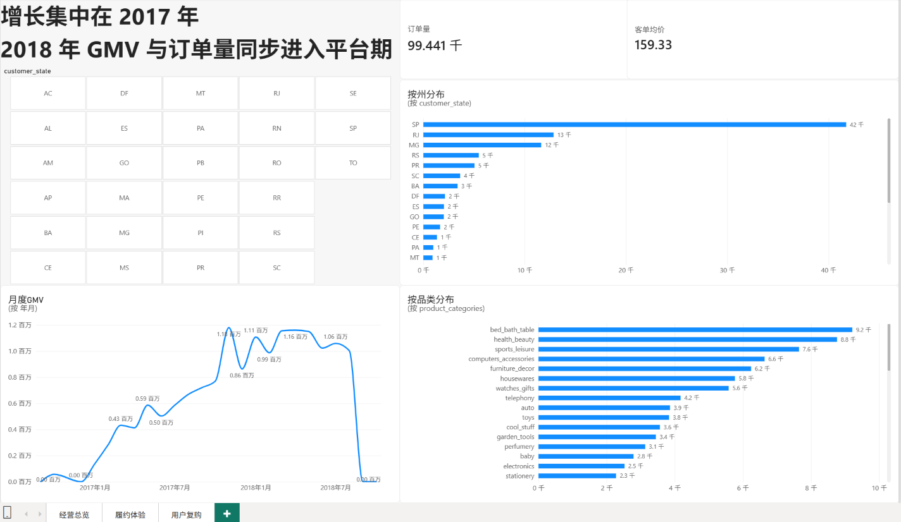

# Olist 电商履约体验与用户复购分析

基于 Olist 巴西电商公开数据集（99,441 笔订单）的端到端数据分析项目。项目围绕「履约体验 → 用户满意度 → 复购」展开，使用 SQL 构建订单级宽表，结合 Python / Power BI 完成分析与可视化，并输出可执行的运营建议。


## 1. 业务问题

1. 平台增长主要由哪些地区、品类驱动？
2. 延迟交付集中在哪些地区、品类和卖家？
3. 延迟交付是否伴随更低评分和更低复购？
4. 如果只能优先改善一件事，应该先做什么？

## 2. 数据说明

数据来源：[Olist Brazilian E-Commerce Public Dataset](https://www.kaggle.com/datasets/olistbr/brazilian-ecommerce)

| 文件 | 行数 | 说明 |
|---|---:|---|
| `olist_orders_dataset.csv` | 99,441 | 订单与四个履约时间点 |
| `olist_order_items_dataset.csv` | 112,650 | 订单商品明细（一单多行） |
| `olist_customers_dataset.csv` | 99,441 | 客户，含 `customer_unique_id` |
| `olist_products_dataset.csv` | 32,951 | 商品与品类 |
| `olist_order_reviews_dataset.csv` | 99,224 | 评价与评分 |
| `olist_sellers_dataset.csv` | 3,095 | 卖家 |
| `olist_order_payments_dataset.csv` | 103,886 | 支付方式与分期 |
| `product_category_name_translation.csv` | 71 | 品类名葡英对照 |
| `olist_geolocation_dataset.csv` | 1,000,163 | 邮编经纬度（可选） |

> 原始 CSV 不提交到 Git，下载后放到 `data/raw/`。

## 3. 指标口径

| 指标 | 口径 |
|---|---|
| 有效订单 | `order_status = 'delivered'` |
| GMV | `SUM(item_revenue + freight_value)`，按订单去重 |
| 延迟交付 | 实际送达时间 > 预计送达时间 |
| 复购 | 同一 `customer_unique_id` 有 ≥2 笔有效订单 |
| 复购窗口 | 90 天或 180 天，全项目统一 |
| 评分 | 按 `order_id` 去重后的平均 `review_score` |

## 4. 目录结构

```text
olist-ecommerce-analysis/
├── data/
│   ├── raw/                  # 原始 CSV，不提交
│   ├── processed/            # 清洗后的宽表，不提交
│   └── README.md             # 数据来源与放置说明
├── sql/
│   ├── 01_data_quality.sql
│   ├── 02_order_wide.sql
│   ├── 03_user_summary.sql
│   └── 04_analysis.sql
├── notebooks/
│   └── 01_eda.ipynb
├── dashboard/
│   └── README.md
├── reports/
│   ├── figures/              # 所有分析图与看板截图
│   │    └──README.MD         # 图表命名规范
│   ├── 01_data_quality.md    # 数据体检记录
│   ├── 02_metrics_dictionary # 指标字典全项目唯一口径
│   └── olist_analysis_memo.md
├── run_sql.py                # 一键建表并导出宽表
├── README.md
├── requirements.txt
└── .gitignore
```

## 5. 运行方式

### 5.1 准备数据

将 9 个 CSV 文件放到 `data/raw/`，文件名保持不变。

### 5.2 安装依赖

```bash
python -m venv .venv
```

Windows PowerShell：

```powershell
.venv\Scripts\Activate.ps1
pip install -r requirements.txt
```

macOS / Linux：

```bash
source .venv/bin/activate
pip install -r requirements.txt
```

### 5.3 运行 SQL

推荐用一键脚本，不需要单独安装 DuckDB 命令行：

```bash
python run_sql.py
```

脚本会依次执行：

```text
sql/01_data_quality.sql
sql/02_order_wide.sql
sql/03_user_summary.sql
```

运行完成后会生成：

- `olist.duckdb`：包含 `order_wide` 和 `user_summary` 两张表
- `data/processed/order_wide.csv`：可直接导入 Power BI

`sql/04_analysis.sql` 是探索性查询，建议在 `notebooks/01_eda.ipynb` 中逐条运行。

## 6. 当前进度

- [x] 目录与数据说明
- [x] 数据质量检查
- [x] 订单宽表
- [x] 履约分析
- [x] 复购与 RFM 分析
- [x] Dashboard
- [x] 一页纸报告

## 7. 关键发现

1. 延迟率整体 **8.11%**（7,826 / 96,478，仅 `delivered`，`delivered_ts > estimated_ts`）；高延迟州全部 ≥12%，但按率排名会指向小样本——AL 23.9% 只有 397 单，RJ 13.5% 有 12,350 单，相差约 31 倍。
2. 增长集中在 2017 年：月度 GMV 从接近 0 升到约 1,150 千 BRL，2018 年在 950—1,120 千 BRL 平台期震荡；2016-11 无订单、2018-09/10 不完整属原数据集采集缺口，首尾月不纳入趋势判断。
3. 延迟订单平均评分 **2.57 分**，比未延迟 **4.29 分**低 **1.73 分**（n=7,661 / 88,171，已排除无评价订单）；整体复购率仅 **3.00%**（2,801 / 93,358，全观察期口径）。评分差是伴随关系，不是因果结论。

> 口径与数字以 `reports/02_metrics_dictionary.md` 为准；完整论证见 `reports/olist_analysis_memo.md`。

## 8. 业务建议

1. **按延迟订单绝对数而不是延迟率挑改善地区**，优先 RJ 一类大样本州（依据发现 1）。验证：该州延迟订单绝对数、延迟率、平均评分前后对比。
2. **对高延迟卖家设履约门槛**，先把样本门槛从 30 单提到 100 单，考核时同时公布 `n`（依据发现 1，Top20 里 18/20 家不足 100 单）。验证：门槛内卖家延迟订单绝对数与评分。
3. **对 7,826 单延迟订单做补偿与召回**，按延迟订单用户圈选而非 RFM「重要保持用户」（仅 191 人）（依据发现 3）。验证：A/B 或前后对照的平均评分与复购率。本项目未做实验，效果为待验证假设，未编造提升比例。

## 9. 局限与复盘

- 数据只覆盖 2016-2018 年，不能直接代表当前市场。
- 延迟与复购是相关关系，不能直接下因果结论。
- Olist 复购率天然较低，需要区分平台特性与运营问题。
- 部分订单缺少送达时间或评价，分析时需要说明样本范围。
- 2016-11 无任何订单、2018-09/10 不完整，属原数据集采集缺口；已排除出趋势判断，不是清洗问题。
- 延迟与评分、复购均为相关关系；本项目**未做用户级「延迟 vs 复购」验证**，只有订单级评分对比与州级分组差异。
- 品类与卖家经 `UNNEST` 拆成「品类-订单对」「卖家-订单对」，分母不是 96,478 单订单，不能与整体 8.11% 相减；`unknown` 是品类翻译表未匹配的兜底值，非真实品类。
- RFM 用绝对硬阈值（R 90/180 天、M 500/300）而非分位数，且 97% 用户只买过一次，分层几乎无区分度；「重要保持用户」仅 191 人、收入占比 1.08%，不足以支撑单独召回策略。
