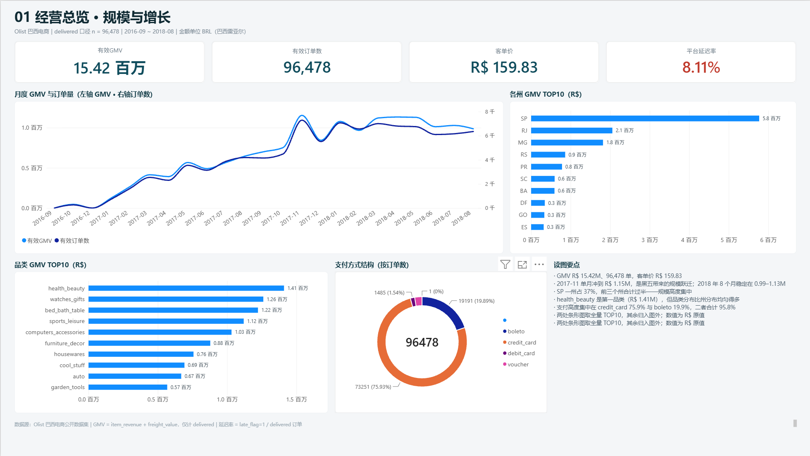

# Dashboard 说明

将 Power BI 文件保存为 `dashboard/olist_dashboard.pbix`。
> pbix 因体积原因未入库。如需可编辑文件，请邮件 3087409713@qq.com，24 小时内回复。

建议三页：

1. **经营总览**：月度 GMV、订单量、客单价、州/品类分布
2. **履约体验**：配送天数分布、延迟率、高延迟州/卖家排名
3. **用户复购**：复购率、RFM 分层

导出截图到 `reports/figures/`，建议文件名：

- `dashboard_overview.png`
- `dashboard_delivery.png`
- `dashboard_retention.png`

README 中引用示例：

```markdown

```
